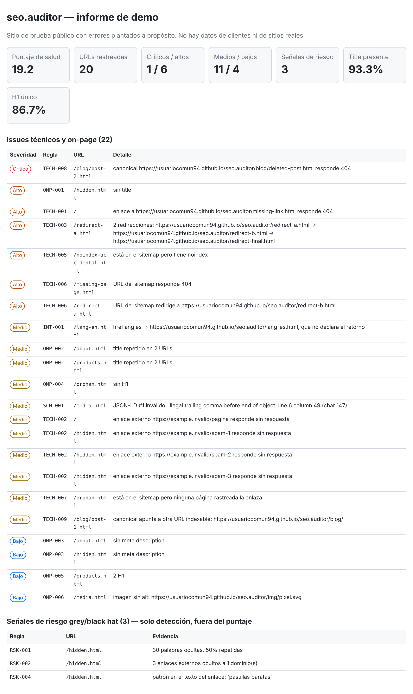

# seo.auditor

**Auditor SEO autónomo, multicliente y de costo $0.** Rastrea un sitio, detecta problemas técnicos y on-page, marca señales de riesgo grey/black hat (solo detección) y reporta a Google Sheets. Corre solo en GitHub Actions, sin servidores ni APIs de pago.

> **English:** an autonomous, multi-client, zero-cost SEO auditing engine. It crawls a site, flags technical and on-page issues, detects grey/black-hat *risk signals* (detection only, never execution), measures performance (PageSpeed/CrUX) and Search Console gaps, and writes to Google Sheets. It runs on a GitHub Actions cron with no paid APIs. Competitor mode is enforced in code (robots.txt, polite delay, URL cap, honest user-agent). Docs below are in Spanish; the code, rule catalog and tests are self-explanatory.

[Ver informe de demo](https://usuariocomun94.github.io/seo.auditor/demo/report.html) · [Caso de estudio](docs/CASE_STUDY.md) · [Guía de uso](docs/USAGE.md)



*Informe generado contra un sitio de prueba público con errores plantados a propósito. No hay datos de clientes ni de sitios reales.*

## Qué hace

| Área | Detalle |
|---|---|
| Técnico | Enlaces rotos, cadenas y bucles de redirección, canonicals, noindex accidental, sitemap vs. realidad, páginas huérfanas, X-Robots-Tag |
| On-page | Title, meta description, H1, duplicados, imágenes sin alt |
| Datos estructurados e internacional | JSON-LD inválido, hreflang sin retorno |
| Rendimiento | PageSpeed Insights (laboratorio) y CrUX (campo) con reglas de Core Web Vitals |
| Search Console | Páginas sin impresiones, CTR bajo en top 10, URLs que Google conoce y el crawl no encontró |
| Riesgo grey/black hat | Texto y enlaces ocultos, cloaking, spam saliente, páginas puerta: **solo detección**, fuera del puntaje |
| Seguimiento | Puntaje de salud 0–100, diff entre corridas (nuevo / recurrente / resuelto), histórico |
| Multi-sitio | Panel en Drive con configs privadas, pestañas Comparativa y Benchmark solo para el administrador |
| Competencia | Modo `competitor` con límites validados por código ([ética](docs/ETHICS.md)) |
| Sitios con JavaScript | Renderizado con Chromium, activado solo en plataformas que lo necesitan |

## Decisiones de diseño que lo distinguen

- **Mide contra una verdad conocida.** El sitio de prueba tiene errores plantados y un archivo de esperados: el crawler detecta 24 de 24, y las señales de riesgo aparecen solo donde se plantaron (sin falsos positivos en las demás páginas).
- **Los límites se dicen en voz alta.** [`docs/LIMITS.md`](docs/LIMITS.md) separa lo que se puede, lo que no y lo que depende de la plataforma. Una celda vacía significa "no medible", nunca "0".
- **Un número que falta no es un problema resuelto.** Si el crawl se trunca o PageSpeed no responde, los issues anteriores se conservan, no se marcan como arreglados.
- **Seguridad pensada para un repo público.** Los logs públicos ocultan nombres, dominios e IDs; los pedidos del crawler y del navegador a redes privadas se bloquean; las planillas se escriben en modo `RAW` para evitar inyección de fórmulas. Ver [`docs/PRIVACY.md`](docs/PRIVACY.md).
- **$0 de verdad.** GitHub Actions, Google Sheets/Drive/Search Console y las APIs gratuitas de PageSpeed y CrUX.

## Cómo funciona

```
Panel (Drive, privado) ──►  GitHub Actions (cron / manual)  ──►  crawler Python (+ Chromium si hace falta)
                                                                      │
                          ┌───────────────────────────────────────────┤
                          ▼                                           ▼
            Una planilla por sitio                         Panel: Comparativa y Benchmark
   (Resumen, Issues, Histórico, Riesgo, Crawl,             (solo para el administrador)
    Rendimiento, Search Console)
```

## Probalo en 2 minutos

```bash
pip install -r requirements.txt && pip install -e .
pytest                                    # sin red: usa servidores locales
python -m seo_auditor --config clients/fixture.yaml --expected fixture/EXPECTED_ISSUES.yaml
python scripts/make_demo.py               # regenera el informe de demo
```

La guía completa (modo Panel, secretos, Search Console, reglas, puntaje, diff entre corridas) está en [`docs/USAGE.md`](docs/USAGE.md).

## Estado

Fases 0 a 6 completas. Limitaciones conocidas: el puntaje no está calibrado contra una muestra amplia de sitios reales (sirve para comparar corridas del mismo sitio); la detección de texto oculto ve CSS en línea, no hojas de estilo externas; la tabla de límites por plataforma incluye solo los casos de alta confianza.
